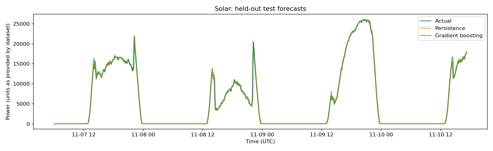
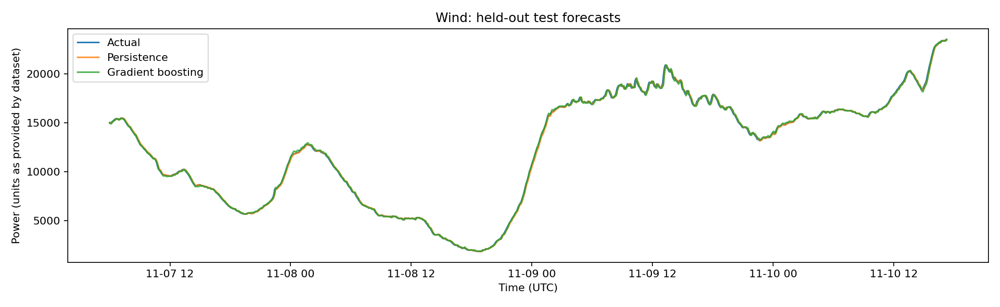
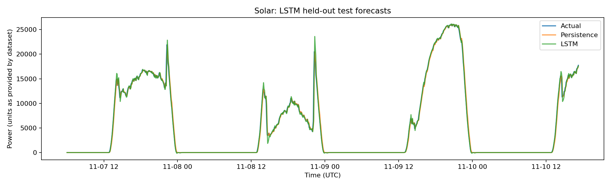
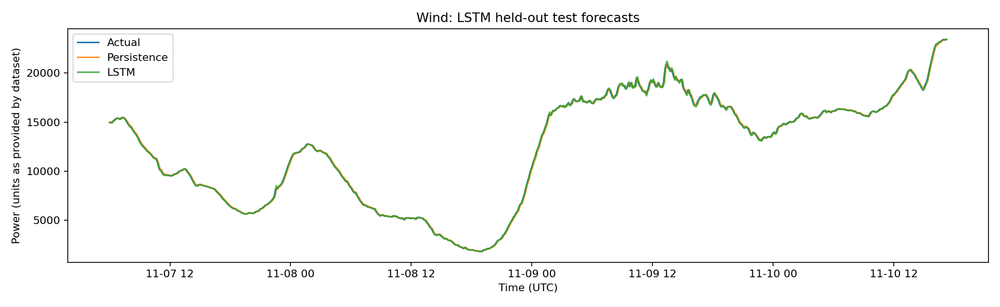

# RenewCast: Renewable Energy Forecasting

RenewCast is a machine-learning project exploring short-term solar and wind generation forecasting. It compares persistence forecasts with machine-learning models to measure how well they predict future generation from historical time-series patterns.

The motivation is practical: renewable output varies over time, and more reliable forecasts can help grid planners anticipate changes in available generation. This repository is an experimental forecasting study, not a deployed grid-control system.

## Objectives

- Build a reproducible pipeline for solar and wind generation time series.
- Establish a persistence baseline before testing more complex models.
- Compare gradient-boosting and LSTM models using held-out data.
- Report errors with standard regression metrics and inspect forecast plots.
- Identify the limitations that should be addressed before using the approach operationally.

## Dataset

The initial experiments use actual-generation time series from the NREL ARPA-E PERFORM dataset.

- Dataset documentation: [PERFORM Forecasts documentation](https://github.com/PERFORM-Forecasts/documentation)
- Dataset access and examples: [PERFORM documentation repository](https://github.com/PERFORM-Forecasts/documentation)

The notebook expects HDF5 actuals files for the selected solar and wind series. Check the file metadata and column definitions before interpreting a selected column as a site, balancing-authority series, or system-wide generation. The data's units and aggregation level should be reported as provided by the source.

## Methods

The current baseline workflow includes:

1. **Data validation** — inspect HDF5 datasets, parse timestamps, remove invalid observations, sort the time index, and handle duplicate timestamps.
2. **Time-series features** — use past generation values, rolling summaries, and calendar features.
3. **Chronological evaluation** — split the data into training, validation, and test periods in time order.
4. **Persistence baseline** — predict the next value using the latest observed generation.
5. **Gradient boosting** — compare a tree-based regression model with persistence.
6. **LSTM** — optionally evaluate a recurrent neural network on historical generation windows.
7. **Evaluation** — calculate MAE, RMSE, and normalized MAE; save predictions, metrics, models, and plots.

### Important scope distinction

The initial implementation uses historical generation and calendar features. It should **not** be described as weather-aware forecasting until weather forecasts available at the time of prediction have been aligned with the generation target and evaluated separately. Using future weather observations would introduce information leakage.

## Forecast plots

The following figures are saved by the experiment pipeline. They show predictions on the held-out test period; the plotted window is a subset of the test data for readability.

### Solar generation

### Wind generation

### Solar LSTM

### Wind LSTM

If a figure is not present in a run—for example, when the LSTM section was skipped—its image will not render until the corresponding plot is generated and committed.

## Metrics

The primary metrics are:

| Metric | Meaning |
| --- | --- |
| MAE | Mean absolute difference between predictions and actual generation |
| RMSE | Root mean squared error, which gives greater weight to larger errors |
| Normalized MAE | MAE divided by the stated reference range, expressed as a percentage |

The reported percentage error reduction is calculated against the persistence baseline:

$$
\text{Error reduction (\%)} =
\frac{\text{MAE}_{\text{persistence}} - \text{MAE}_{\text{model}}}
{\text{MAE}_{\text{persistence}}} \times 100
$$

A positive value means the model's MAE is lower than persistence; a negative value means it performs worse. Results should always be reported alongside the dataset period, forecast horizon, aggregation level, and test-split method. Metrics from different sites or generation scales should not be compared without context.

## Repository outputs

The notebook can generate the following artifacts:

- renewcast_outputs/combined_metrics.csv — combined model metrics
- renewcast_outputs/*_metrics.csv — per-technology metrics
- renewcast_outputs/*_predictions.csv — timestamped actual and predicted values
- renewcast_outputs/plots/ — forecast figures
- renewcast_outputs/models/ — serialized models
- renewcast_outputs/experiment_report.json — experiment configuration, metrics, and limitations

Generated output paths may differ depending on the notebook version. Only commit artifacts that were produced by the experiment you are reporting.

## Running the experiment

The notebook is designed for Google Colab or a Python environment with the required packages.

1. Clone or download this repository.
2. Open the forecasting notebook in Google Colab.
3. Install the listed Python dependencies.
4. Obtain the relevant actual-generation HDF5 files using the official PERFORM documentation.
5. Upload the files to the Colab session or place them in the notebook's working directory.
6. Set the solar and wind filenames in the configuration cell.
7. Run the notebook from top to bottom.
8. Review the HDF5 metadata, check the generated metrics, and inspect the held-out forecasts before reporting results.

The notebook uses Python libraries including NumPy, pandas, h5py, scikit-learn, Matplotlib, joblib, and TensorFlow for the optional LSTM experiment.

## Limitations and next steps

- The initial feature set does not include aligned weather forecasts.
- A single selected series may not represent a full grid or region.
- Performance on one time period or grid region does not establish global generalization.
- Forecast accuracy alone does not demonstrate improved grid operations; operational value would require further evaluation.
- LSTM performance depends on the selected lookback window, horizon, data quality, and training setup.

The next research step is to add genuine weather forecast variables—such as solar irradiance and cloud cover for solar, and wind speed and direction for wind—using only forecasts that would have been available at prediction time. These models should be compared with the existing baselines on the same chronological test period.

## References

- National Renewable Energy Laboratory, ARPA-E PERFORM Forecasts documentation: https://github.com/PERFORM-Forecasts/documentation
- PERFORM dataset DOI: https://dx.doi.org/10.25984/1891136

## Project status

RenewCast is a research prototype. Reported performance should be treated as specific to the evaluated data and configuration; no claim of real-world grid deployment or operational impact is made.
